<h1 align="center">Decide</h1>

<p align="center">
  <b>One shared 17M-parameter model that makes three support-desk decisions on a CPU in ~6 ms,<br>
  with probabilities you can trust and an honest “not sure” when it should be.</b>
</p>

<p align="center">
  
  
  
  
  
</p>

<p align="center">
  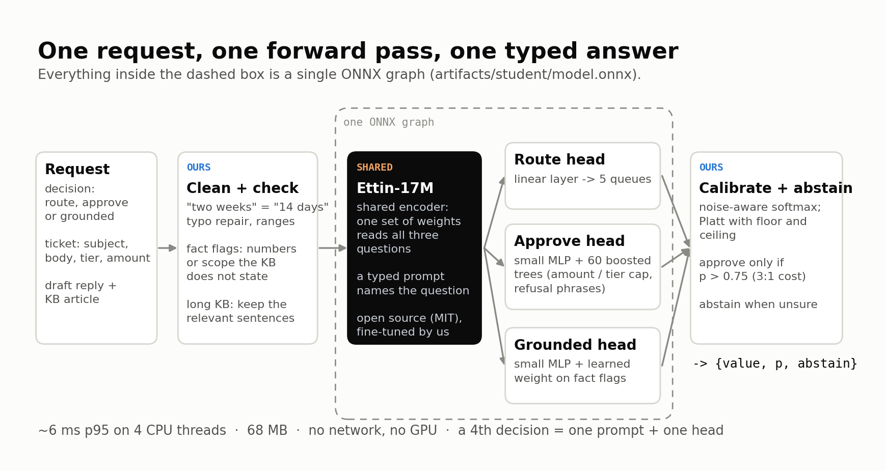 clean and check -> shared Ettin-17M encoder -> route, approve and grounded heads (all in one ONNX graph) -> calibrate and abstain" width="100%">
</p>

`POST /v1/decide` answers three typed questions about a customer-support ticket:

| Decision | Question | Answer |
|---|---|---|
| **route** | Which queue should handle it? | billing / technical / account / shipping / general, with probabilities |
| **approve** | Auto-approve the refund? A wrong “yes” costs 3× a wrong “no”. | yes / no + `p_true` |
| **grounded** | Is every claim in the draft reply backed by the help article? | yes / no + `p_true` |

All three come from **one fine-tuned encoder in one ONNX graph**. Every answer carries a calibrated
probability and an `abstain` flag that hands the case to a human. Serving is CPU only, with no network
calls and no API keys.

---

## Results

`selfcheck.py` on `data/dev.jsonl` (1500 records, 4500 calls). Full output in `results.json`.

| Part | Score | Weight | Points |
|---|---|---|---|
| Quality | 0.856 | 40% | 34.26 |
| Calibration | 0.876 | 25% | 21.90 |
| Latency (p95 5.2 ms) | 1.000 | 20% | 20.00 |
| Abstention | 0.647 | 15% | 9.71 |
| **Total** | | | **85.87 / 100** |

All gates pass: schema 4500 / 4500 valid, reachable, latency under 100 ms.

---

## Quick start

Start the service (one command, on a clean 4-core Linux box with Python 3.10+):

```bash
./start.sh
```

It runs the starter kit's two steps, `pip install -r requirements.txt` then
`uvicorn app:app --host 0.0.0.0 --port 8000`. The service listens on port **8000**.

In a second terminal, while the server is running:

```bash
python selfcheck.py --url http://localhost:8000/v1/decide
```

The weights ship in the repo (`artifacts/student/`, 68 MB), so nothing has to be downloaded or trained.

### The API

```bash
curl -s localhost:8000/v1/decide -H 'content-type: application/json' -d '{
  "request_id": "demo-1", "decision": "approve",
  "state": {"subject": "Charged twice this month",
            "body": "Hi, I was billed twice for my Pro plan on the 3rd. Could you check and reverse one of them? Thanks.",
            "customer_tier": "pro", "amount": 29.0, "draft_reply": "", "kb_article": ""}}'
```

```json
{"type": "binary", "value": true, "p_true": 0.8486, "abstain": false,
 "request_id": "demo-1", "decision": "approve", "latency_ms": 1.8}
```

A vague ticket gets a flat distribution and is handed to a human:

```json
{"type": "choice", "value": "technical", "confidence": 0.343, "abstain": true,
 "probs": {"technical": 0.343, "account": 0.308, "billing": 0.224, "shipping": 0.098, "general": 0.028},
 "request_id": "demo-2", "decision": "route", "latency_ms": 1.2}
```

### `test.py`: run any dataset, see every answer

```bash
python test.py path/to/other.jsonl --limit 20     # default: data/test.jsonl if present, else data/dev.jsonl
```

No server needed. It asks every record all three decisions in the judges’ shuffled order and prints each
answer (with `ABSTAIN` and `ok`/`XX` against the label), then timing per decision, accuracy and the total
from the same metric code as `selfcheck.py`. Labels are optional. One JSON object per line:

```json
{"request_id": "req-005178",
 "state": {"subject": "...", "body": "...", "customer_tier": "enterprise", "amount": 0.0,
           "draft_reply": "...", "kb_article": "..."},
 "labels": {"route": "billing", "approve": true, "grounded": true}}
```

---

## Live demo

```bash
python demo/demo_ui.py        # http://localhost:8000/   (#case=N opens preset N, &eval runs the mini-evaluation)
python demo/demo.py           # the same cases in the terminal, against a running service
```

The page serves the graded `/v1/decide` unchanged and adds preset cases, an editable ticket, the gate-1
baseline’s answer next to ours, an amount slider for approve, a live latency test, and a
**mini-evaluation** that pushes random dev tickets through both models, clean and rewritten, scored with
the judges’ code.

<p align="center">
  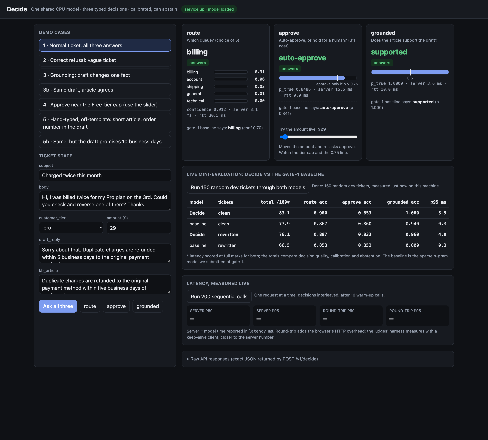
  <br><sub>One live run of 150 random dev tickets (numbers move a little from run to run). On rewritten tickets
  the baseline drops to 66.5; Decide keeps 76.1.</sub>
</p>

<table>
<tr>
<td width="50%">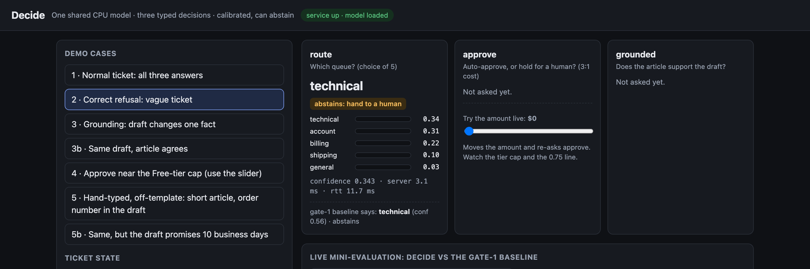<br>
<sub><b>A correct refusal.</b> “Can someone help with my account please”: no queue above 0.34, so it abstains.</sub></td>
<td width="50%">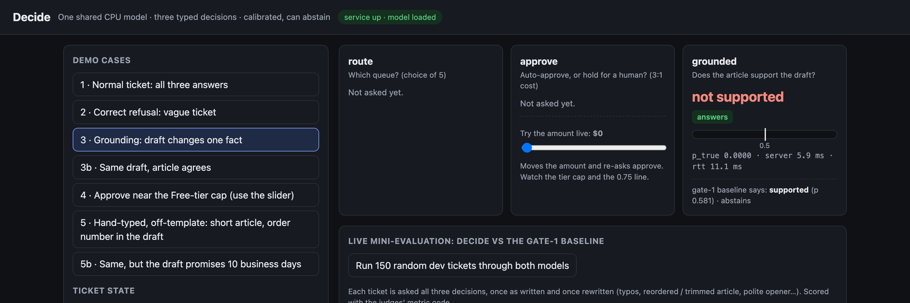<br>
<sub><b>One changed fact.</b> The draft says <i>monthly</i>, the article says <i>annual</i>. Decide: not supported (p 0.000). Baseline: supported.</sub></td>
</tr>
</table>

---

## How it works

### One shared model, and where the sharing happens

* **`decide/textfmt.py`**: every decision is a *(typed prompt, state)* pair fed to the same encoder.
  The prompt (`route:`, `approve:`, `grounded:`) names the question, so one set of weights reads all three.
* **`decide/net.py`**: `DecideNet` has one `encoder` and three small heads (route: a 1.3k-parameter
  linear layer; approve and grounded: MLPs of ~84k each). About **99% of the parameters are shared**.
* **`artifacts/student/model.onnx`**: **one graph, three outputs**. Each call runs the shared encoder
  once and the API returns the head that was asked for.
  * The approve head’s second layer, 60 boosted trees (~2.7k numbers), is compiled into the same graph
    as a standard `TreeEnsembleRegressor` node (`tools/embed_stage.py`). It reads the head’s own logit,
    so it cannot run without the shared encoder, and it leaves route and grounded untouched.

<details>
<summary><b>The three prompts, and the path of one request</b></summary>

```
             state + typed question
                      │
     normalise numbers/durations ("two weeks" → "14 days")
                      │
   "route: <subject> | <body>"            ┐
   "approve: <tier> $<amount> | ..."      ├─ one prompt per decision
   "grounded: <draft>" [SEP] "<kb>"       ┘
                      │
          ┌───────────▼────────────┐
          │  shared encoder         │   Ettin-17M (ModernBERT recipe), fine-tuned
          │  (one ONNX graph)       │   multi-task on all three decisions
          └───────────┬────────────┘
                 mean-pool h
        ┌─────────────┼─────────────────────┐
   route head     approve head            grounded head
   Linear→5     MLP([h, aux])          MLP([h, aux]) + w·flags
        │        → 60 boosted trees           │
        │          (logit, amount÷cap, …)     │
   noise-aware    Platt w/ ceiling,       Platt, p > 0.5
   softmax        approve iff p > 0.75
        │             │                     │
   abstain if     abstain if p in         abstain only if
   low top-prob   (0.17, 0.83)            undecided
```
</details>

**Adding a fourth decision is cheap, and we measured it**.
We trained on route and approve only, then added grounded later as if it were new: one prompt, one head,
**89 s** of training with old batches replayed. It scored **83.2** against **83.6** for training all three
together (noise ±1.1), and route and approve kept their accuracy.

<p align="center">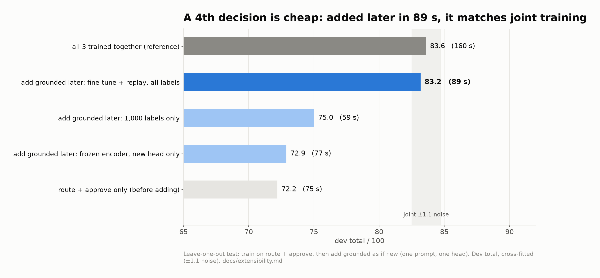</p>

### Route: a contextual encoder, honest about noisy labels

Multi-issue tickets mark the main issue with cue phrases (“the main thing I need resolved”), and
distractor sentences borrow other queues’ vocabulary, so a contextual encoder matters. About 5–6% of
routing labels are unrelated to the ticket text, so calibration uses a noise-aware softmax,
`p = (1−ε)·softmax(z/T + b) + ε/5`, that never claims more than ~95%.

### Grounded: read the draft and the article together, and check the facts

Wrong drafts differ from the article in one slot: a number (“fifteen” vs “thirty minutes”), an audience
(“administrators” vs “all users”) or a scope (“monthly” vs “annual”). So the draft and the article go
into the encoder **together** as one pair (a cross-encoder).

* **Normaliser** (`decide/normalize.py`): every duration and number word becomes one canonical form using
  the data’s own conventions (“a month” = 30 days, “a year” = 365 days, “a quarter of an hour” = 15 minutes),
  with one-typo repair (“hudnred”, “busniess”) and ranges (“3 to 5 days” → “3-5 days”). Before this, most
  confident grounding errors were unit arithmetic.
* **Fact flags**: after normalising, *no supported draft in train or dev states a number + unit that its
  article does not*. So “any unsupported number”, “how many” and “share supported”, plus a scope-broadening
  check, go into the grounded head next to the encoder output. Numbers copied from the ticket (order IDs,
  the charged amount) are ignored.
* **Long articles** (over 5 sentences; training articles have 2–4): the encoder reads the four sentences that share the
  draft’s rarest terms; the fact flags still read the whole article. Every train and dev input is
  byte-identical with or without this.

### Approve: text plus amount, then a tree layer, then the 3:1 rule

<p align="center">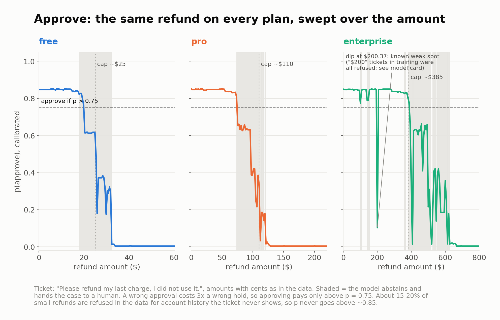</p>

* The approve head reads the pooled text **and** a small tabular vector (tier, tier × amount bucket, log amount).
* Its second layer, **60 boosted trees** (`decide/approve_stage.py`), refines that logit with amount ÷ the
  tier’s cap (caps estimated from train labels) and the disqualifying-phrase flags. It is fitted on
  **out-of-fold** logits, so it corrects the network’s real over-confidence: **+1.0 point** cross-fitted.
* With a calibrated `p`, the 3:1 cost makes approving right only when `3(1−p) < p`, i.e. **p > 0.75**.
  Near the cap the model is unsure and hands the case to a human.

<p align="center">
  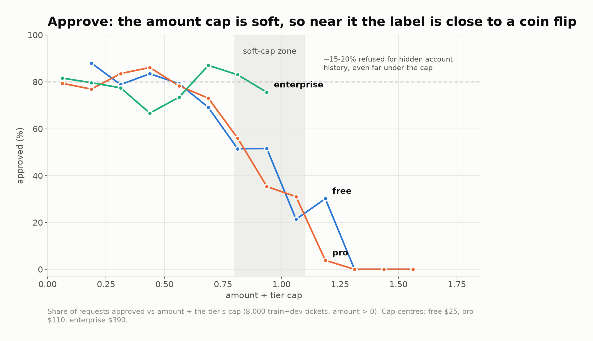
  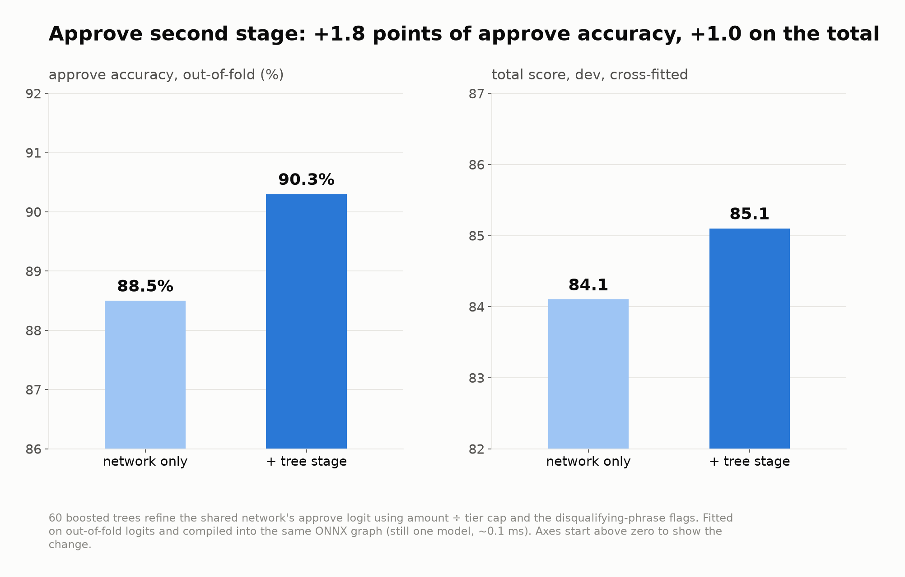
</p>

### Calibration and abstention

<p align="center">
  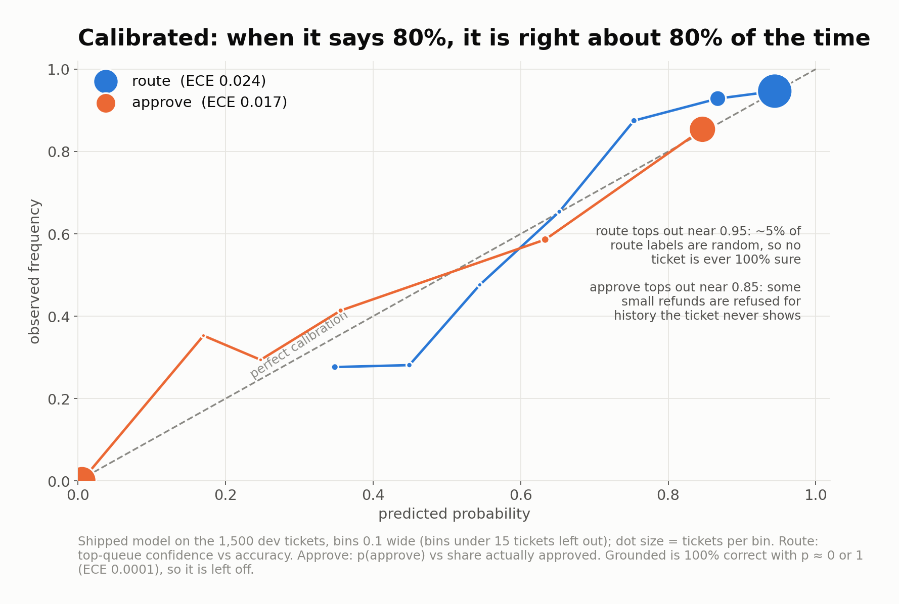
  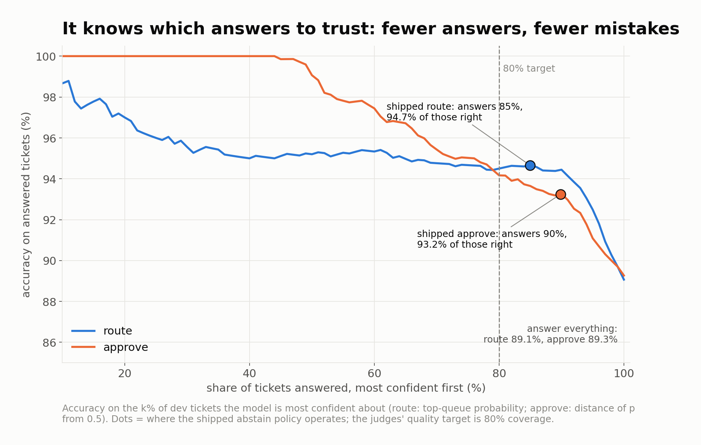
</p>

* **Calibration is label-noise aware.** Route uses the ε-floor softmax above. The binaries use Platt
  scaling with a learned floor and ceiling, `lo + (hi−lo)·sigmoid(a·z + b)`, because ~20% of approvable
  requests are refused for account history the ticket never shows. On 6,500 out-of-fold predictions this
  raises the calibration score from 0.832 to 0.858.
* **What is fitted where.** The noise parameters (ε, bias, floor, ceiling) come from the 6,500
  out-of-fold predictions. Only the scales (T, a, b) and the abstain thresholds are refitted on dev.
* **Abstention is tuned per decision** against an in-process copy of the judges’ scorer
  (`decide/scoring.py`). Each decision keeps the smallest abstain share (up to 15%, coverage floor 0.85)
  that reaches the best quality. Route abstains on the ~15% least confident tickets, approve when p is
  between 0.17 and 0.83 (~10%), grounded essentially never.

---

## Robustness: tested beyond the training template

The training data is heavily templated. A judge, or real traffic, will not be. We rewrote dev in 14
label-preserving ways (`tools/stress_test.py`) and wrote 64 hard tickets by hand (`tests/`).

<p align="center">
  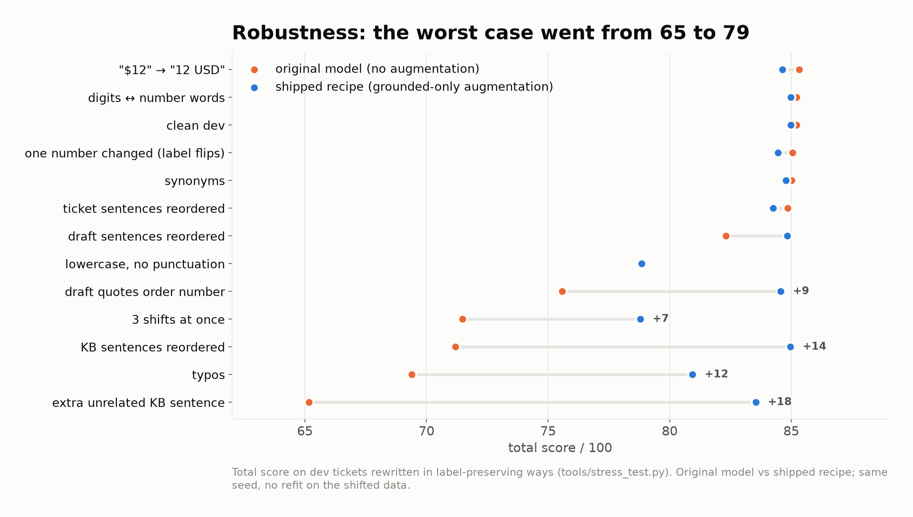
  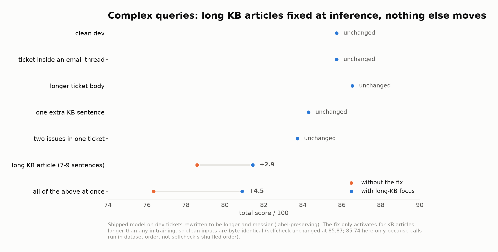
</p>

* **Label-preserving augmentation** of the training rows only (typos, reordered, trimmed or extended
  articles, polite openers and sign-offs; `decide/augment.py`), on grounded batches. The worst shifted
  variant went from **65 to 79** at no cost on clean dev.
* **Long pasted tickets** are clipped to 4,000 characters per field (8× the longest in the data): a
  20,000-word input went from 2.8 s to 14 ms.
* **Hand-written sets**: `tests/complex_cases.json` (multi-issue tickets, quoted threads, emoji,
  chargeback threats, drafts with several claims) **29 / 31**; `tests/judge_cases.json` **25 / 33**,
  including 7 known gaps found by an independent audit (see the model card).

---

## Limits and the ceiling

<p align="center">
  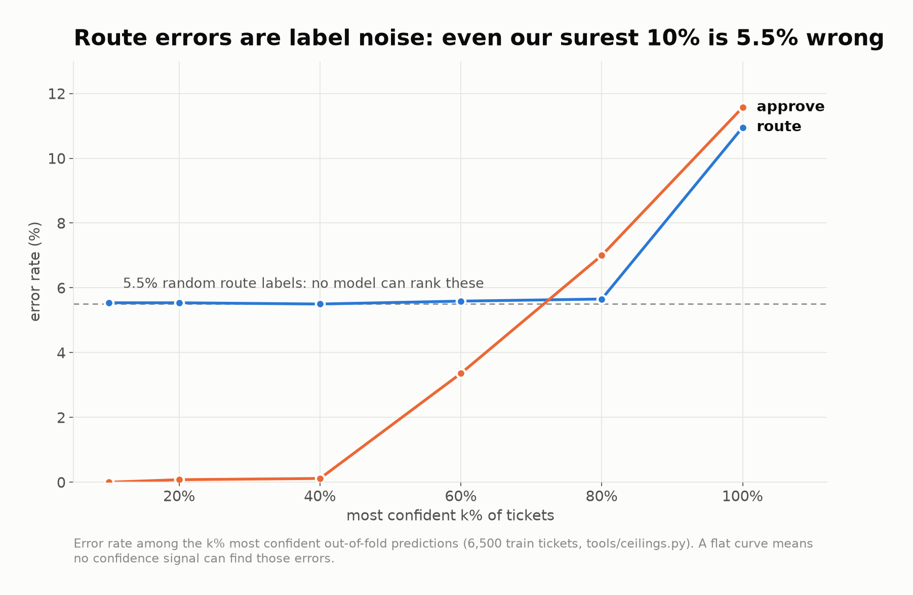
  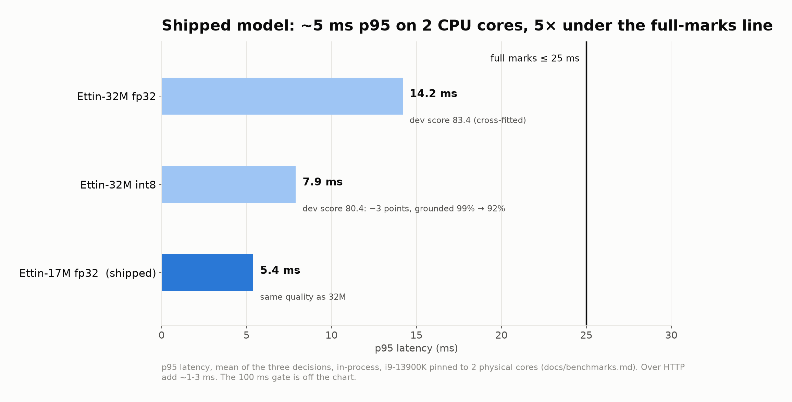
</p>

* **Route labels are noisy.** Even our most confident 10% of tickets are wrong 5.5% of the time, the same
  rate as everywhere else. No confidence signal can find those errors, and route abstention sits within
  0.01 of its mathematical ceiling.
* **Some refusals are hidden.** They depend on account history; no model we tried predicts them better
  than chance (AUC 0.46–0.52).
* **Speed over precision was the wrong trade here.** int8 halves latency but drops grounded accuracy from
  99% to 92%; we are already 4× under the 25 ms full-marks line, so we ship fp32.
* **Known weak spots** (all in [`model_card.md`](model_card.md)): refusal reasons worded unlike the
  training data, drafts that change a day or a place rather than a number, “1 day” vs “24 hours”, and
  whole-dollar amounts the training text only ever saw refused (the dip at $200 on the enterprise curve).

<details>
<summary><b>What we tried that did not help</b></summary>

<p align="center">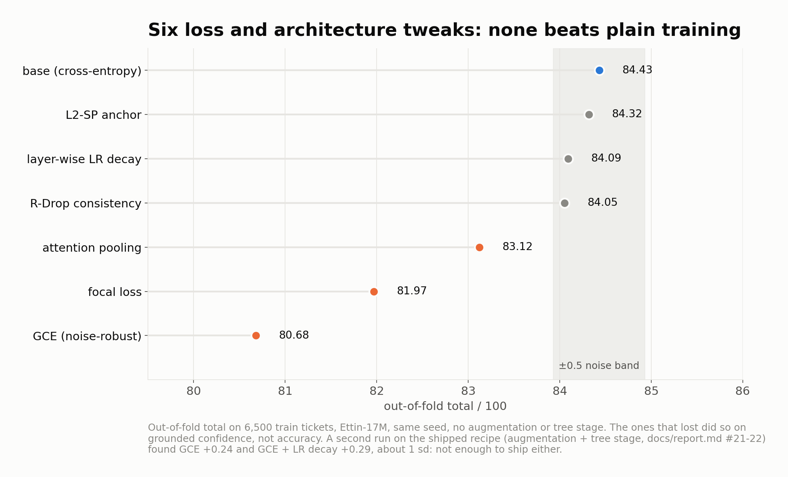</p>

| Idea | Result |
|---|---|
| Bigger encoders (Ettin-32M / 150M / 400M) | same quality, 2.7× slower and up |
| Distillation from DeBERTa-v3-large, Ettin-400M, a Laya-initialised encoder | no gain: the limit is label noise, not capacity |
| 4-seed logit ensemble | 84.0 vs 84.8 for the best single seed |
| Weight soups | hurt grounded |
| int8 quantisation | −3 points |
| Approve features inside the network instead of the tree layer (v7, v8) | no better: the network memorises the hidden refusals |
| Noise-robust losses, R-Drop, LLRD, attention pooling, L2-SP | within noise or worse |
| More training data (5,000 → 6,500 tickets) | +0.8, the one thing that still helps |
</details>

---

## Reproduce

```bash
pip install -r requirements-train.txt                                     # GPU box
python training/train_baseline.py                                         # gate-1 sparse baseline
M=jhu-clsp/ettin-encoder-17m
C="--model $M --epochs 6 --lr 1e-4 --prompt short --augment 2 --augment_tasks grounded"
python training/train_mt.py $C --out runs/v6t2_e17                        # 5-fold out-of-fold run
python training/train_mt.py $C --out runs/v6t2h_e17_s3 --full --seed 3    # the shipped network
python tools/fit_approve_stage.py runs/v6t2_e17 runs/v6t2h_e17_s3         # tree layer on OOF logits
./training/finalize.sh runs/v6t2_e17_st runs/v6t2h_e17_s3_st exports/v6t2h_s3_st   # calibrate, export, benchmark
python tools/embed_stage.py exports/v6t2h_s3_st --check data/dev.jsonl    # trees into the ONNX graph
python training/pack_student.py exports/v6t2h_s3_st exports/v6t2h_s3_st/policy.json
python tools/stress_test.py                                               # shifted-dev robustness check
```

Run everything from the repository root. `training/train_baseline.py` takes no arguments and overwrites
`artifacts/baseline.pkl`.

## Repository layout

```
.
├── app.py              HTTP layer from the starter kit (fixed API contract)
├── model.py            DecisionModel: loads the shipped model and its policy
├── start.sh            installs requirements and starts the server on :8000
├── selfcheck.py        the judges' check (schema, latency, score) against a live URL
├── test.py             any dataset in-process: answers, timing, accuracy, score
├── decide/             the model code
│   ├── normalize.py        number / duration normaliser shared by all decisions
│   ├── textfmt.py          typed prompts, fact flags, tabular features, long-KB focus
│   ├── net.py              shared encoder + three heads
│   ├── approve_stage.py    the approve head's tree layer
│   ├── policy.py           calibration, 0.75 approve rule, abstain tuning
│   ├── student_runtime.py  tokenizer + ONNX Runtime session
│   ├── augment.py          label-preserving training augmentation
│   └── scoring.py          in-process copy of the selfcheck maths
├── artifacts/          the shipped model (student/) and the gate-1 baseline
├── training/           training, calibration, export and packing
├── tools/              stress test, hand-written cases, CPU benchmark, ONNX build helpers
├── tests/              hand-written judge-style and complex-query cases
├── demo/               live demo page and terminal demo
└── docs/               methodology, figures, demo screenshots
```

## Pretrained components and licences

| Component | Used for | Licence |
|---|---|---|
| [jhu-clsp/ettin-encoder-17m](https://huggingface.co/jhu-clsp/ettin-encoder-17m) | **shipped backbone** | MIT |
| [jhu-clsp/ettin-encoder-32m](https://huggingface.co/jhu-clsp/ettin-encoder-32m) | compared: same quality, 2.7× slower | MIT |
| [jhu-clsp/ettin-encoder-150m / -400m](https://huggingface.co/jhu-clsp) | teachers (training experiments only) | MIT |
| [microsoft/deberta-v3-large](https://huggingface.co/microsoft/deberta-v3-large) | teacher (training only) | MIT |
| [convaiinnovations/laya](https://huggingface.co/convaiinnovations/laya) encoder | teacher initialisation (training only) | Apache-2.0 (per its model card) |
| [KRLabsOrg/tinylettuce-ettin-17m-en](https://huggingface.co/KRLabsOrg/tinylettuce-ettin-17m-en) | initialisation experiment (not shipped) | MIT |

* **Serving libraries:** ONNX Runtime (MIT), Hugging Face tokenizers (Apache-2.0), FastAPI (MIT),
  uvicorn (BSD-3), NumPy (BSD-3).
* **Training only:** PyTorch (BSD-3), transformers (Apache-2.0), ONNX (Apache-2.0), scikit-learn (BSD-3),
  SciPy (BSD-3), matplotlib (PSF-style, figures only).
* **Training data:** only the provided train split. The augmentation rewrites provided train rows
  without changing their labels: no new labels, no external or LLM-generated data, and dev is never
  augmented.
* **Versions we ran:** Python 3.11, onnxruntime 1.23/1.31, tokenizers 0.22, fastapi 0.161,
  torch 2.8 and transformers 5.20 (training).

## Further reading

| Doc | What it covers |
|---|---|
| [`docs/methodology.md`](docs/methodology.md) | every stage from the baseline to 85.9, with numbers |
| [`model_card.md`](model_card.md) | intended use, metrics, when it abstains, where it fails |

<p align="center"><sub>Built in 12 hours by Sahil (<code>sahilapage</code>) and Arhan (<code>4rhan</code>) for the Decide hackathon.</sub></p>
