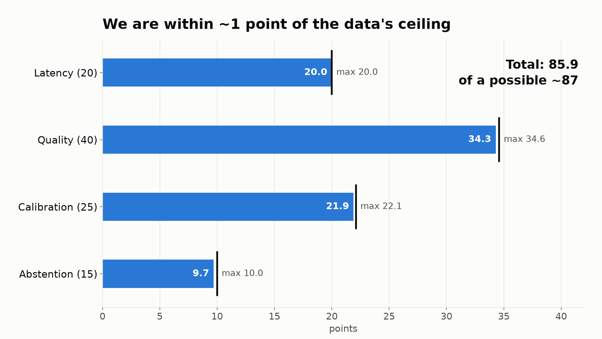
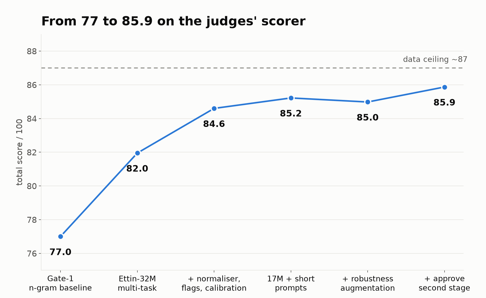

# Decide

One shared 17M-parameter model that answers three support-desk decisions on CPU,
with calibrated probabilities and an abstain flag.

| Decision | Question |
|---|---|
| **route** | Which queue: billing, technical, account, shipping or general? |
| **approve** | Auto-approve the refund? (a wrong "yes" costs 3× a wrong "no") |
| **grounded** | Is every claim in the draft reply backed by the help article? |

<p align="center"></p>

## Results

`selfcheck.py` on `data/dev.jsonl` (1500 records, 4500 calls). Full output in `results.json`.

| Part | Score | Weight | Points |
|---|---|---|---|
| Quality | 0.856 | 40% | 34.26 |
| Calibration | 0.876 | 25% | 21.90 |
| Latency (p95 5.2 ms) | 1.000 | 20% | 20.00 |
| Abstention | 0.647 | 15% | 9.71 |
| **Total** | | | **85.87 / 100** |

All gates pass: schema 4500 / 4500 valid, reachable, latency under 100 ms.

## Quick start

```bash
./start.sh
```

Runs `pip install -r requirements.txt` then `uvicorn app:app --host 0.0.0.0 --port 8000`.
Then, in a second terminal:

```bash
python selfcheck.py --url http://localhost:8000/v1/decide
```

The weights are in the repo (`artifacts/student/`, 68 MB). Nothing to download or train.

## Where the sharing happens

All three decisions go through **one encoder** (`jhu-clsp/ettin-encoder-17m`, fine-tuned).
A typed prompt (`route:`, `approve:`, `grounded:`) tells it which question is asked.
About 99% of the parameters are shared; each decision has only a small head on top
(`decide/net.py`). Everything runs as one ONNX graph on CPU, with no network calls.

## Graphs

<p align="center">
  
  
</p>

## Reproduce

```bash
pip install -r requirements-train.txt                                     # GPU box
python training/train_baseline.py                                         # gate-1 baseline
M=jhu-clsp/ettin-encoder-17m
C="--model $M --epochs 6 --lr 1e-4 --prompt short --augment 2 --augment_tasks grounded"
python training/train_mt.py $C --out runs/v6t2_e17                        # 5-fold out-of-fold run
python training/train_mt.py $C --out runs/v6t2h_e17_s3 --full --seed 3    # the shipped network
python tools/fit_approve_stage.py runs/v6t2_e17 runs/v6t2h_e17_s3
./training/finalize.sh runs/v6t2_e17_st runs/v6t2h_e17_s3_st exports/v6t2h_s3_st
python tools/embed_stage.py exports/v6t2h_s3_st --check data/dev.jsonl
python training/pack_student.py exports/v6t2h_s3_st exports/v6t2h_s3_st/policy.json
```

## Pretrained models and licences

| Model | Used for | Licence |
|---|---|---|
| [jhu-clsp/ettin-encoder-17m](https://huggingface.co/jhu-clsp/ettin-encoder-17m) | shipped backbone | MIT |
| [jhu-clsp/ettin-encoder-32m / -150m / -400m](https://huggingface.co/jhu-clsp) | compared / teachers (training only) | MIT |
| [microsoft/deberta-v3-large](https://huggingface.co/microsoft/deberta-v3-large) | teacher (training only) | MIT |
| [convaiinnovations/laya](https://huggingface.co/convaiinnovations/laya) | teacher (training only) | Apache-2.0 |
| [KRLabsOrg/tinylettuce-ettin-17m-en](https://huggingface.co/KRLabsOrg/tinylettuce-ettin-17m-en) | experiment (not shipped) | MIT |

Training data: only the provided train split. Versions: Python 3.11, onnxruntime 1.23,
tokenizers 0.22, fastapi 0.161; training with torch 2.8 and transformers 5.20.

More detail: [`model_card.md`](model_card.md) and [`docs/methodology.md`](docs/methodology.md).
